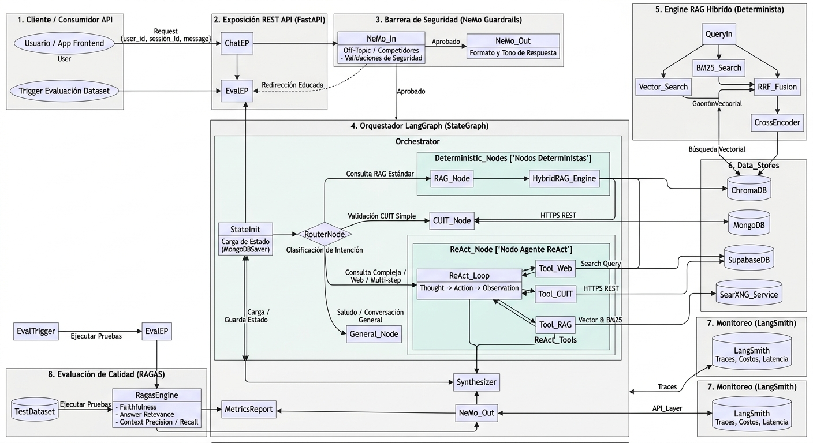
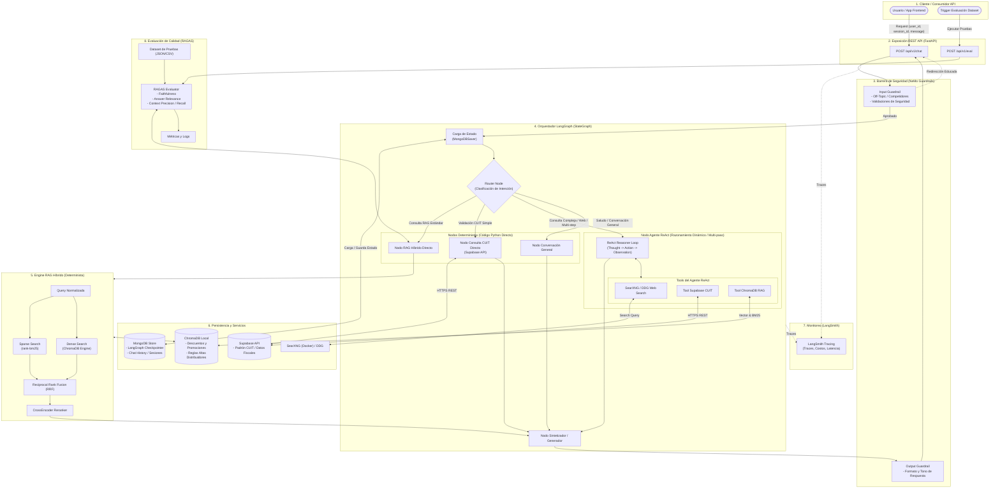

# PRD: Sistema Conversacional AI de Producción — Proyecto Ortelana

## 1. Visión General del Producto

El propósito del sistema conversacional de **Ortelana** es ofrecer un asistente omnicanal listo para producción capaz de atender consultas sobre productos, descuentos, reglas de alta de distribuidores, validación fiscal de CUITs y búsquedas de información web en tiempo real.

El sistema utiliza **LangGraph** como orquestador principal combinando nodos de ejecución determinista (para máxima velocidad y menor costo) con un nodo de agente **ReAct** (para resolver consultas complejas multi-paso o ambiguas).

---

## 2. Arquitectura de Sistema y Flujo de Datos



<details>
<summary> Mermaid FlowChart </summary>

</details>
---

## 3. Especificaciones Tecnológicas (Tech Stack)

| Componente | Tecnología | Descripción / Propósito |
| --- | --- | --- |
| **REST API** | FastAPI + Uvicorn | Exposición de endpoints HTTP asíncronos para integración con apps móviles o web. |
| **Barrera de Seguridad** | NeMo Guardrails | Faltas de respeto, temas *off-topic*, menciones a competidores y formateo de respuesta. |
| **Orquestador** | LangGraph (`StateGraph`) | Gestión de estado, routing determinista y ejecución del nodo Agente ReAct. |
| **Vector DB Local** | ChromaDB | Almacenamiento persistente local para embeddings de promociones y reglas de alta. |
| **Sparse DB Search** | `rank-bm25` | Indexación y búsqueda exacta por palabras clave sobre los textos de ChromaDB. |
| **Re-ranker** | `sentence-transformers` (CrossEncoder) | Reordenamiento semántico de candidatos RAG obtenidos tras la fusión RRF. |
| **Base de Datos Operacional** | MongoDB (`pymongo` / `langgraph-checkpoint-mongodb`) | Almacenamiento de checkpoints de LangGraph (`MongoDBSaver`) e historial conversacional. |
| **Servicios Externos** | Supabase REST API / SearXNG | Validación de CUIT fiscal / Buscador web auto-hospedado en Docker (fallback: DuckDuckGo). |
| **Monitoreo** | LangSmith | Trazabilidad de llamadas LLM, tiempos de latencia, costos por token y logs de herramientas. |
| **Evaluación** | RAGAS | Evaluación periódica/bajo demanda de métricas de calidad RAG sobre dataset de prueba. |

---

## 4. Requerimientos Funcionales por Módulo

### 4.1. API & Barreras de Seguridad (FastAPI + NeMo Guardrails)

* **Entrada Segura:** Toda solicitud entrante a `/api/v1/chat` debe pasar por `Input Guardrail` en NeMo Guardrails antes de tocar el grafo.
* **Reglas de Negocio en Guardrails:**
* Si el usuario pregunta sobre empresas competidoras, el guardrail intercepta y responde educadamente reorientando la atención a Ortelana.
* Si la consulta es destructiva o fuera de lugar (*off-topic*), rechaza la petición sin invocar el LLM principal.


* **Salida Segura:** Las respuestas del sintetizador pasan por `Output Guardrail` para garantizar formato, tono corporativo y ausencia de alucinaciones críticas.

### 4.2. Orquestación y Routing (LangGraph)

* **Gestión de Estado (`AgentState`):** Conserva `user_id`, `session_id`, `messages`, variables temporales de CUIT y contexto recuperado.
* **Router Classifier:** Clasifica la intención del usuario en una de las siguientes rutas:
1. `rag_direct`: Consultas simples y directas sobre promociones, catálogo o reglas de alta.
2. `cuit_direct`: Solicitudes directas de verificación o relevamiento de un CUIT.
3. `react_agent`: Consultas complejas que combinan más de una intención, preguntas ambiguas o búsquedas que requieran información web en tiempo real.
4. `general`: Saludos o soporte conversacional básico.


### 4.3. Engine RAG Híbrido (Determinista)

* **Migración:** Datos origen cargados en ChromaDB local con sus metadatos (categoría, vigencia, tipo de documento).
* **Flujo de Recuperación:**
1. **BM25 Search:** Procesa la consulta normalizada contra el índice `rank-bm25`.
2. **Vector Search:** Realiza similtud coseno/distancia L2 sobre ChromaDB.
3. **Reciprocal Rank Fusion (RRF):** Aplica la fórmula de ordenamiento sobre ambos listados con parámetro constante $k=60$:

$$RRF\_Score(d) = \sum_{m \in M} \frac{1}{k + r_m(d)}$$


4. **CrossEncoder Reranker:** Toma los top $N$ documentos resultantes de RRF y reordena utilizando un modelo de CrossEncoder para entregar únicamente el contexto más relevante al sintetizador.


### 4.4. Agente ReAct & Tools (Consultas Dinámicas)

* **Casos de Uso del Agente:** Consultas compuestas (*"¿Tienen tela para frío, stock en sucursal y qué necesito para darme de alta con mi CUIT 30-12345678-9?"*).
* **Herramientas Expuestas (`@tool`):**
* `Tool_Chroma_RAG`: Permite al agente consultar información interna de Ortelana cuando lo necesite dentro del bucle de pensamiento.
* `Tool_Supabase_CUIT`: Llama a la API de Supabase enviando el CUIT para ratificar el estado y la condición fiscal del usuario.
* `Tool_SearXNG_Web`: Llama a la instancia local de SearXNG (`http://localhost:8888`) o DuckDuckGo en caso de fallo para consultar información externa.


### 4.5. Persistencia y Memoria

* **Checkpoints:** Cada paso dentro del `StateGraph` se guarda en MongoDB usando la integración oficial `MongoDBSaver`.
* **Continuidad Conversacional:** Usando `thread_id` (mapeado a `session_id`), el chatbot recupera el historial de la conversación previa para mantener el contexto entre distintos turnos de diálogo.

### 4.6. Trazabilidad & Evaluación (LangSmith + RAGAS)

* **LangSmith:** Configuración automática mediante variables de entorno (`LANGCHAIN_TRACING_V2=true`). Mide consumo de tokens, latencia de herramientas y árbol de decisiones del router.
* **Evaluación RAGAS (`POST /api/v1/eval`):**
* Lee un dataset de prueba configurado en el servidor (`JSON` con preguntas, contextos de referencia y respuestas esperadas).
* Ejecuta la evaluación calculando:
* **Faithfulness** (Fidelidad de la respuesta con respecto al contexto).
* **Answer Relevance** (Relevancia de la respuesta entregada al usuario).
* **Context Precision & Recall** (Efectividad y cobertura del motor RAG Híbrido).


---

## 5. Especificación de Endpoints (REST API)

### `POST /api/v1/chat`

Endpoint principal para interacción conversacional.

* **Request Body:**

```json
{
  "user_id": "usr_9981",
  "session_id": "sess_123456",
  "message": "Hola, necesito saber si tienen tela térmica para frío y si me pueden dar de alta con el CUIT 30-71123456-8"
}

```

* **Response Body (200 OK):**

```json
{
  "session_id": "sess_123456",
  "response": "¡Hola! Para confección de prendas de abrigo te recomendamos Gabardina Térmica... Tu CUIT figura activo como Responsable Inscripto. Para darte de alta necesitamos...",
  "routing_used": "react_agent",
  "guardrail_status": "passed"
}

```

---

### `POST /api/v1/eval`

Trigger de ejecución de baterías de pruebas para monitorear la calidad del sistema.

* **Request Body:**

```json
{
  "dataset_name": "eval_ortelana_v1",
  "metrics": ["faithfulness", "answer_relevance", "context_precision", "context_recall"]
}

```

* **Response Body (200 OK):**

```json
{
  "status": "completed",
  "samples_evaluated": 50,
  "scores": {
    "faithfulness": 0.94,
    "answer_relevance": 0.91,
    "context_precision": 0.88,
    "context_recall": 0.92
  },
  "timestamp": "2026-10-26T15:30:00Z"
}

```

---

## 6. Plan de Implementación por Fases

1. **Fase 1: Infraestructura Base & RAG Híbrido**
* Configurar servicios locales en Docker (`SearXNG`, `MongoDB`, `ChromaDB`).
* Migrar documentos de MongoDB a ChromaDB.
* Construir e probar el script Python de búsqueda híbrida ($BM25 + Vector \rightarrow RRF \rightarrow CrossEncoder$).


2. **Fase 2: Construcción del Grafo en LangGraph**
* Definir el estado `AgentState`.
* Implementar `router_node`, `rag_node`, `cuit_node` y el sub-agente `react_agent_node` con sus herramientas (`Tools`).
* Integrar `MongoDBSaver` para la persistencia de conversaciones.


3. **Fase 3: Seguridad y Capa API (FastAPI + NeMo)**
* Configurar las colang/rails de NeMo Guardrails para filtrado de competidores y mensajes *off-topic*.
* Crear la API REST con FastAPI e integrar los guardrails en los endpoints.


4. **Fase 4: Observabilidad y Evaluación (LangSmith + RAGAS)**
* Conectar LangSmith mediante API Keys para traza completa.
* Crear el dataset de pruebas inicial y programar la lógica del endpoint `/api/v1/eval` usando la librería RAGAS.
